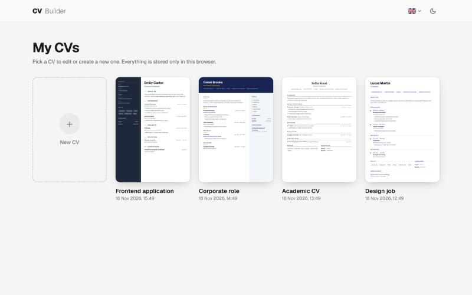
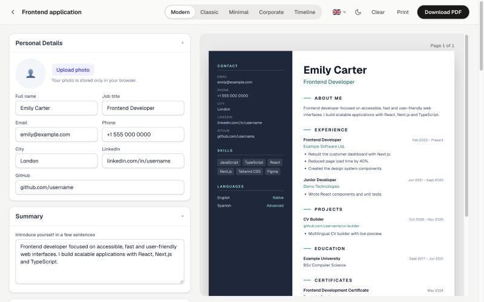
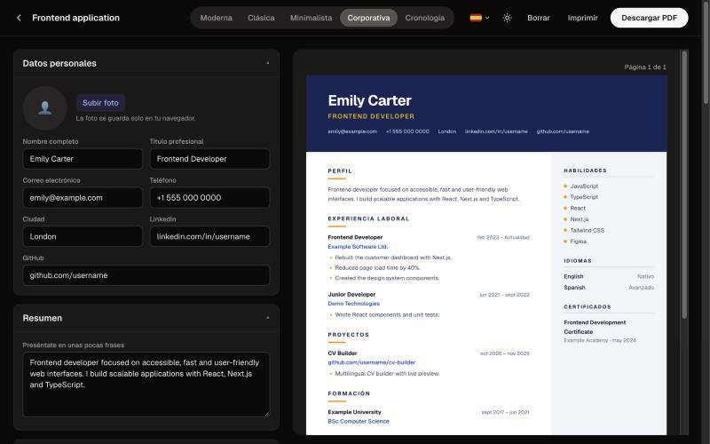

# CV Builder

A browser-based CV builder with a live preview. Fill in the form on the left and watch your CV update on the right, page by page, exactly as it will look in the PDF.

There is no backend and no account. Everything is stored in your browser's `localStorage`, so your data never leaves your device.







## Features

- **Multiple CVs**: keep a separate CV for each application. Name a new CV when you create it, and pick up where you left off later.
- **Live preview on real A4 pages**: the preview is split into pages the same way the PDF is, with the page count shown as you type.
- **Smart page breaks**: entries and bullet points are never cut in half, section headings move to the next page together with their content, and long paragraphs break between lines.
- **5 templates**: Modern, Classic, Minimal, Corporate and Timeline. You can switch templates at any time without losing data.
- **All the usual sections**: personal details, summary, work experience, projects, education, certificates, skills, languages and references. List entries can be added, removed and reordered.
- **Profile photo**: the photo is resized in the browser (to about 5 KB) and is never uploaded anywhere.
- **PDF export**:
  - **Download PDF** generates the file directly, with clickable links.
  - **Print** opens the browser's print dialog. Choose "Save as PDF" there to get a PDF with selectable text, which applicant tracking systems (ATS) can read.
- **4 languages**: Turkish, English, Spanish and Italian. The whole interface and the CV headings, dates and language levels follow the selected language.
- **Light and dark theme**: follows your system setting until you choose one.
- **Responsive**: on small screens, separate tabs switch between the form and the preview.

## Tech stack

| | |
|---|---|
| Framework | [Next.js 16](https://nextjs.org) (App Router) and [React 19](https://react.dev) |
| Language | [TypeScript](https://www.typescriptlang.org) |
| Styling | [Tailwind CSS 4](https://tailwindcss.com) |
| Validation | [Zod](https://zod.dev): data read from `localStorage` is validated before use |
| PDF | [modern-screenshot](https://github.com/qq15725/modern-screenshot) and [jsPDF](https://github.com/parallax/jsPDF) |
| Tests | [Vitest](https://vitest.dev) |

No UI kit and no i18n library are used; the translation system is a small typed module (see below).

## Getting started

You need [Node.js](https://nodejs.org) 20.9 or later.

```bash
git clone https://github.com/juuniordeveloper/cv-olusturucu.git
cd cv-olusturucu
npm install
npm run dev
```

Then open [http://localhost:3000](http://localhost:3000).

### Scripts

| Command | What it does |
|---|---|
| `npm run dev` | Starts the development server with hot reload |
| `npm run build` | Builds the production version |
| `npm start` | Serves the production build |
| `npm test` | Runs the unit tests |
| `npm run lint` | Checks the code with ESLint |

> Don't run `npm run build` while `npm run dev` is running. Both use the `.next` folder, and the development server can end up serving stale files.

## Project structure

```
src/
├── app/                  Routes: "/" (CV list) and "/cv/[id]" (editor)
├── components/
│   ├── home/             CV list, cards and the "new CV" dialog
│   ├── editor/           Editor screen
│   ├── form/             Form sections
│   ├── templates/        The 5 CV templates
│   ├── CvPreview.tsx     Live preview: measuring and page splitting
│   └── PreviewSheet.tsx  A single A4 page in the preview
├── hooks/                State and behaviour (saving, CV list, theme, language)
├── lib/                  Pure logic with unit tests
│   ├── cvRepository.ts   Storing and loading CVs (repository pattern)
│   ├── pagination.ts     Where to break pages
│   ├── pdf.ts            PDF generation
│   └── i18n/             Languages and translations
└── types/cv.ts           Shape of the CV data
```

A detailed walkthrough of every file is available in Turkish in [REHBER.md](REHBER.md).

## How it works

- **Storage**: each CV is saved under its own `localStorage` key, plus a small index for the list. Changes are saved automatically shortly after you stop typing, and immediately when you go back to the list or close the tab.
- **Pagination**: the preview renders the CV once at full A4 width to measure every entry and line, then decides where each page should break. The on-screen pages and the PDF use the same breakpoints, so what you see is what you get.
- **Translations**: `src/lib/i18n/messages/tr.ts` is the source of truth, and the other languages must match its shape. TypeScript reports an error if a translation is missing, and a test checks that no string is empty.

### Adding a language

1. Add the language code to `LOCALES` in `src/lib/i18n/locales.ts`, along with its name and Intl tag.
2. Copy `src/lib/i18n/messages/tr.ts` to a new file and translate it.
3. Register the new file in `src/lib/i18n/messages.ts`.
4. Draw its flag in `src/components/Flags.tsx`.

### Adding a template

1. Create a component in `src/components/templates/`. Copying an existing template is the easiest way to start.
2. Add its id to `TEMPLATE_IDS` in `src/types/cv.ts` and register it in `src/components/templates/index.ts`.
3. Add its display name to the `templates` section of every translation file.

Use `<h2>` for section headings and `<article>` for entries, because the page-break logic relies on these tags.

## Privacy

- Your CVs are stored only in the browser you used to create them, and nothing is sent to a server.
- Clearing your browser data also deletes your CVs.
- A CV created in one browser, or at one address (for example `localhost:3000` and a deployed URL), is not visible in another.

## Known limitations

- **Download PDF** produces an image-based PDF, so its text cannot be selected. Use **Print** and then "Save as PDF" when you need selectable text.
- In multi-page CVs, the descenders of some characters (for example the cedilla in "ş" or "ç") can occasionally be clipped at a page break.
